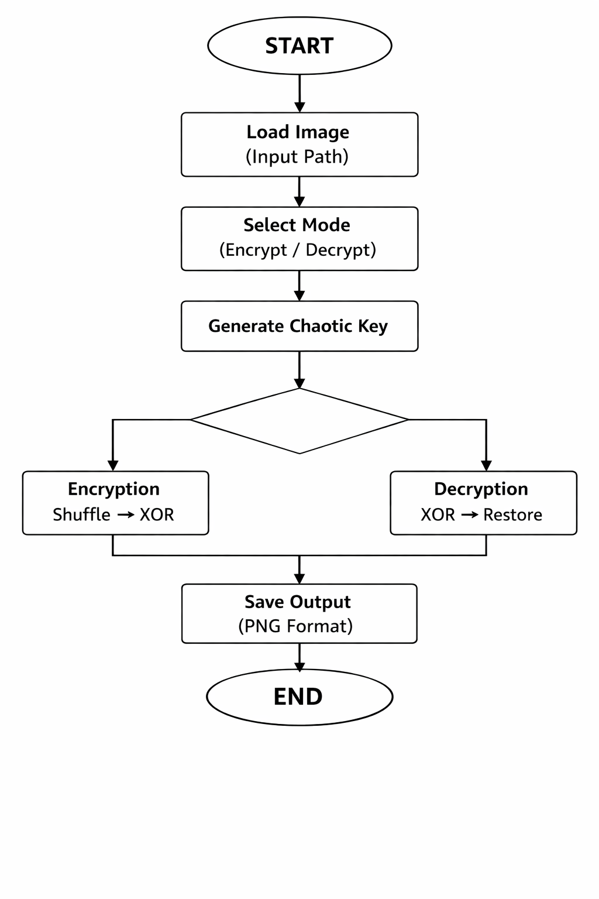
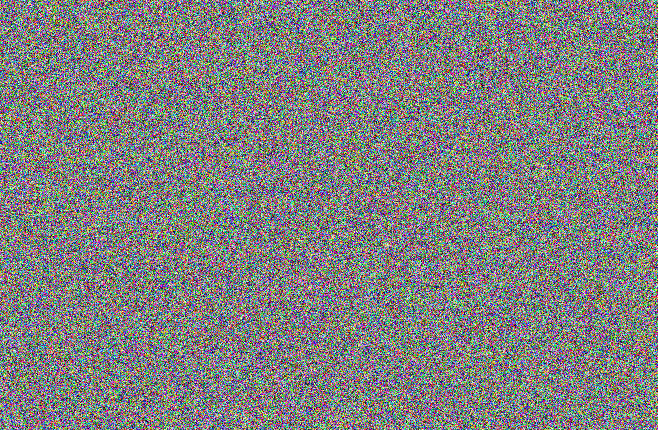

# 🔐 MatrixCrypt

**Secure Image Encryption and Decryption using Chaotic Maps in MATLAB**

MatrixCrypt is an educational image cryptography project that demonstrates how
chaotic systems can be used for image encryption.

The system combines **pixel permutation (confusion)** with **Logistic Map-based
XOR diffusion** to transform an image into visually randomised encrypted data.
The process is completely reversible when the same key and lossless encrypted
image are used.

---

## ✨ Features

- Image encryption and decryption
- Logistic Map-based chaotic key generation
- Deterministic pixel permutation
- XOR-based diffusion
- RGB and grayscale image support
- Lossless encrypted image storage using PNG
- Exact image reconstruction
- Simple command-line interface in MATLAB

---

## 🧠 How It Works

MatrixCrypt uses two main cryptographic concepts:

### 1. Pixel Permutation — Confusion

The positions of pixels are rearranged using a deterministic permutation
generated from the encryption seed.

This breaks the spatial relationship between neighboring pixels.

### 2. Chaotic XOR Diffusion

A pseudo-random key stream is generated using the Logistic Map:

```text
x(n+1) = r × x(n) × (1 - x(n))
```

where the implementation uses:

```text
r = 3.999
```

The generated sequence is converted into 8-bit values and XORed with the
permuted image pixels.

Encryption therefore follows:

```text
Original Image
      ↓
Pixel Permutation
      ↓
Chaotic Key Generation
      ↓
XOR Diffusion
      ↓
Encrypted Image
```

Decryption reverses these operations:

```text
Encrypted Image
      ↓
XOR Diffusion
      ↓
Inverse Pixel Permutation
      ↓
Original Image Restored
```

---

## 🔄 Algorithm Flowchart

<p align="center">
  
</p>

---

## 🖼️ Results

### Original Image

<p align="center">
  
</p>

### Encrypted Image

<p align="center">
  
</p>

### Decrypted Image

<p align="center">
  
</p>

The encrypted output visually resembles random noise, while the decryption
process reconstructs the original image.

---

## 🛠️ Technologies Used

- MATLAB
- Image Processing
- Chaotic Systems
- Logistic Map
- Pseudo-random Permutation
- XOR Operations

---

## 📂 Project Structure

```text
MatrixCrypt/
│
├── src/
│   └── image_cryptography.m
│
├── examples/
│   ├── original.jpg
│   ├── encrypted.png
│   └── decrypted.png
│
├── flowchart.png
├── README.md
└── LICENSE
```

---

## 🚀 Getting Started

### Requirements

- MATLAB
- MATLAB Image Processing functionality

### Run the Project

Clone the repository:

```bash
git clone https://github.com/sec-a-ops/MatrixCrypt.git
```

Open MATLAB and navigate to:

```text
MatrixCrypt/src
```

Run:

```matlab
image_cryptography
```

You will be asked to select an operation:

```text
[E] Encrypt Image
[D] Decrypt Image
```

Enter the full path of the image when prompted.

---

## 🔒 Important Note

Encrypted images should be stored in a **lossless format such as PNG**.

Do not convert an encrypted image to JPEG before decryption. JPEG uses lossy
compression and changes pixel values, preventing exact reconstruction.

---

## ⚠️ Security Disclaimer

MatrixCrypt is an **educational cryptography project** designed to demonstrate
chaotic maps, pixel permutation, and XOR diffusion.

It has not undergone professional cryptographic security analysis and should
not be used as a replacement for established encryption standards such as AES
in security-critical applications.

---

## 🔮 Future Improvements

Potential improvements include:

- User-defined encryption keys
- Multiple chaotic maps
- Multi-key encryption
- Encryption quality metrics such as entropy, NPCR, and UACI
- Histogram and correlation analysis
- Performance optimisation for large images
- Graphical user interface (GUI)

---

## 👨‍💻 Author

**Ansh Bharadwaj**

Developed as an academic project exploring image cryptography and chaotic
systems.

---

## 📄 License

This project is licensed under the MIT License.
